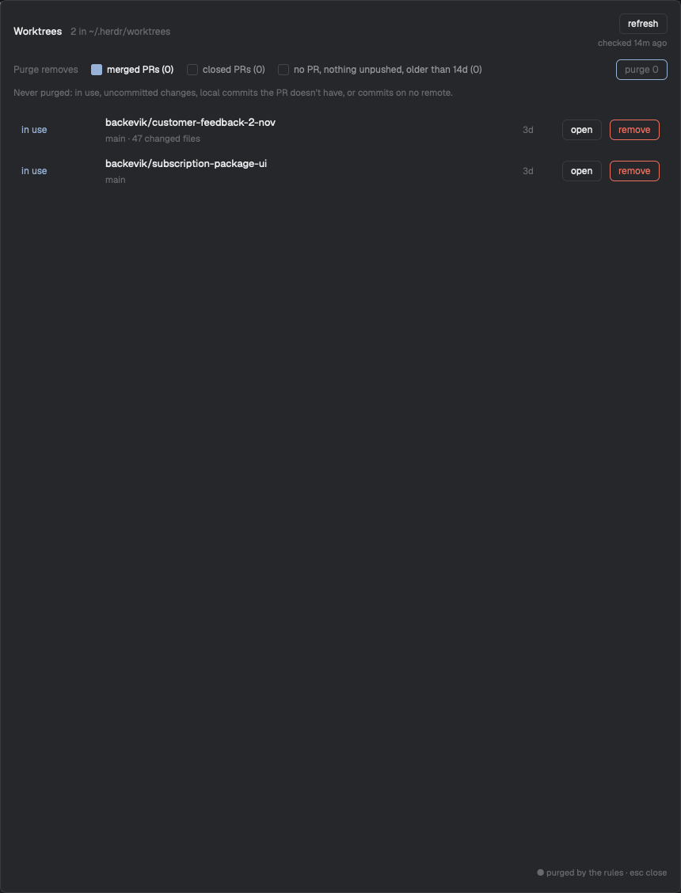

# herdr-mods

Mods for the [Herdr app](https://herdr.dev). Each folder is one mod, laid out the way [herdr.dev/mods](https://herdr.dev/mods) expects: `mods/<name>/`, a `keys.json` snippet, a `preview.png` and a `RECIPE.md` (the brief another agent builds the mod from).

| Mod | What it does | Key |
| :--- | :--- | :--- |
| [Worktree Janitor](worktree-janitor/) | Lists every worktree in `~/.herdr/worktrees` with its PR status and removes the ones you're done with, one at a time or with Purge. | `ctrl-alt-cmd-j` |
| [Annotator Open](annotator-open/) | One key that opens, focuses or closes the [Herdr Annotator](https://github.com/jakub-tucek/herdr-annotator) review pane in the focused tab. | `ctrl-alt-cmd-r` |

<a href="worktree-janitor/"></a>

## Install

Ask your agent, with the link to the mod's folder:

```text
Read ~/.config/herdr-app/AGENTS.md, then add this mod: https://github.com/backevik/herdr-mods/tree/main/worktree-janitor
```

Or follow the install steps in each mod's README.

## Development

```sh
git clone git@github.com:backevik/herdr-mods.git && cd herdr-mods
npm ci
./install.sh
```

`install.sh` symlinks every `*/mods/<name>/` into `~/.config/herdr-app/mods/`. Herdr follows the link, so a save in this repo reloads the mod in the app. Then:

```sh
./check.sh                                        # typecheck + tests + herdr-app check, every mod
herdr-app do mod.open --name <name>               # open it
herdr-app shot preview.png                        # screenshot the window
```

Herdr runs plain JavaScript only (a `main.ts` is refused, and type annotations don't parse), so mods are `.js` typed with [JSDoc](https://www.typescriptlang.org/docs/handbook/jsdoc-supported-types.html) and checked with `tsc`.

- **Logic and UI are split.** `logic.js` in a mod folder holds the decisions and imports nothing from Herdr, so `node --test` runs it. `main.js` gathers facts (git, `gh`, live spaces) and draws.
- **Tests** live in `<mod>/test/*.test.js`, outside the mod folder, so they aren't installed.
- **Types:** `types/gpui-kit.d.ts` is a committed copy of the declarations Herdr writes into each mod folder, for CI, which has no Herdr app. After updating Herdr, run `scripts/update-types.sh` and commit it; `./check.sh` warns when it is out of date.
- **CI** (`.github/workflows/ci.yml`) runs `npm run typecheck` and `npm test` on every push to `main` and every PR. `herdr-app check` needs the desktop app, so it only runs in `./check.sh`.

See [AGENTS.md](AGENTS.md) for conventions.

## License

[MIT](LICENSE) © Andreas Bäckevik
