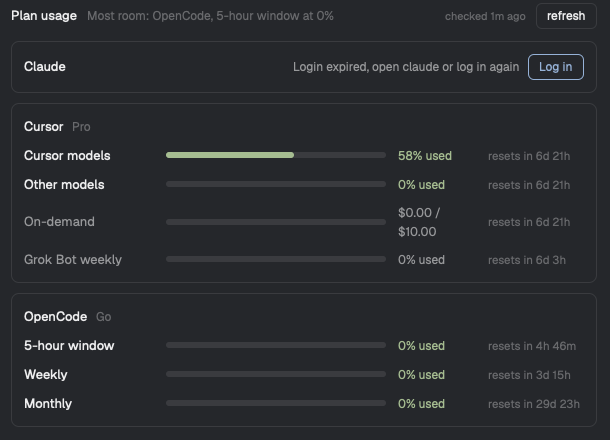

# Plan Usage, a Herdr mod

**How much of your Claude, Cursor and OpenCode Go plans is left, in the status bar.** Each provider's most-used limit sits at the right of the bar, green, yellow from 80% and red from 95%. Click it, or press `ctrl-alt-cmd-u`, for every limit with its reset time and the provider with the most room.



It uses the logins the providers' own CLIs already have. There's no login of its own: when a CLI isn't logged in, **Log in** opens a tab running that CLI's login command.

| Provider | Login it reads | What it shows |
| --- | --- | --- |
| Claude (Pro/Max) | Claude Code: Keychain `Claude Code-credentials`, else `~/.claude/.credentials.json` | 5-hour window, weekly, weekly per model, extra usage |
| Cursor | `cursor-agent`: Keychain `cursor-access-token` | Cursor models, other models, on-demand spend, Grok Bot weekly |
| OpenCode Go | `opencode`: `~/.local/share/opencode/opencode.db` (or the older `auth.json`) | 5-hour window, weekly, monthly |

Cursor's and Claude's endpoints are undocumented: they're what the dashboards use, and they can change without notice. OpenCode's is the one its own client calls. Anthropic limits how Claude Code's login may be used outside its apps; this mod only reads usage with it, and never refreshes it.

## Install

Requires the [Herdr app](https://herdr.dev) (tested on 0.1.13, macOS) and at least one of `claude`, `cursor-agent` and `opencode`, logged in.

```sh
git clone https://github.com/backevik/herdr-mods.git
cp -R herdr-mods/plan-usage/mods/plan-usage ~/.config/herdr-app/mods/
herdr-app check ~/.config/herdr-app/mods/plan-usage
```

Merge [`keys.json`](keys.json) into `~/.config/herdr-app/keys.json`:

```json
{ "global": { "ctrl-alt-cmd-u": "mod.open:plan-usage" } }
```

**Status bar.** Herdr's status bar has no room for other mods, and shipped layouts are read-only, so clone `main` and split its status bar:

```sh
herdr-app do layout.clone '{"name":"main","as":"main-usage"}'
```

In `~/.config/herdr-app/layouts/main-usage.json`, replace the `status` block (`{"id":"status","type":"block","content":{"mod":"workspace-status"},"size":{"px":28}}`) with:

```json
{ "id": "status", "type": "row", "size": { "px": 28 }, "resizable": false, "children": [
  { "id": "status-main", "type": "block", "size": { "weight": 1 }, "content": { "mod": "workspace-status" } },
  { "id": "plan-usage", "type": "block", "size": { "px": 290 }, "content": { "mod": "plan-usage", "props": { "view": "bar" } } }
] }
```

Your clone keeps Herdr's mods, which still update, but not later changes to the `main` layout itself. `ctrl-shift-l` switches back. Without the clone, the dialog still works from the key.

## Use

- **Status bar:** one number per provider, its tightest plan limit. `log in` means the CLI has no valid login; `!` means the last check failed with no earlier numbers to show. Providers without a plan (OpenCode without Go) are left out. Click to open the dialog.
- **Dialog** (`ctrl-alt-cmd-u`, again or Esc closes): every meter with a bar, `% used` and when it resets. On-demand, extra usage and Grok Bot are grey: shown, but never the headline. The top line names the provider with the most room. **refresh** checks again; **Log in** opens a tab with `claude auth login --claudeai`, `cursor-agent login` or `opencode auth login`.
- **Freshness:** the bar checks every 5 minutes, opening the dialog checks numbers older than a minute. A failed check (rate limit, network) keeps the last numbers and says why.

## What this does to your machine

- Runs `security find-generic-password -s "Claude Code-credentials" -w` and `security find-generic-password -s cursor-access-token -w` (the Keychain may ask once to allow it), and `sqlite3 -readonly ~/.local/share/opencode/opencode.db` (one `select` on `credential`).
- Reads `~/.claude/.credentials.json` and `~/.local/share/opencode/auth.json` if they exist.
- Calls, every 5 minutes at most while the bar is shown, and on refresh:
  - `GET https://api.anthropic.com/api/oauth/usage` with Claude Code's access token
  - `GET https://cursor.com/api/usage-summary` and `POST https://cursor.com/api/dashboard/get-sand-usage-status` with a session cookie built from cursor-agent's token
  - `GET https://opencode.ai/zen/go/v1/usage` with opencode's token
- Never refreshes, writes or logs a token. Tokens live in memory for one request. Only the numbers are kept, in Herdr's shared state (`plan-usage.cache` in `~/.config/herdr-app/shared.json`).
- **Log in** opens a Herdr tab running the CLI's login command, which you then complete.
