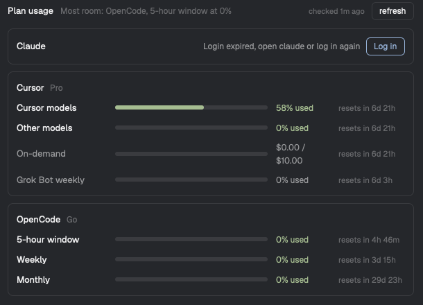

# Plan Usage

How much of your Claude, Cursor and OpenCode Go plans is left, at the right of the status bar: each provider's name and its most-used limit as a percentage, green, yellow from 80%, red from 95%. Clicking it, or `ctrl-alt-cmd-u`, opens a dialog with every limit as a bar with its reset time, and which provider has the most room. It reads the logins the CLIs already have; with none, **Log in** opens a tab running the CLI's login.

## What you see

- **Status bar strip**, a 290px block right of Herdr's `workspace-status` in a 28px row. Background `chrome`, 1px `border` top line, 14px side padding, 12px gaps, items right-aligned, 11.8px text.
  - A 13px `mods/workspace-chrome/clock.svg` in `muted`; while checking, `mods/workspace-chrome/spinner.svg` turning every 900 ms.
  - Per provider, in the order Claude, Cursor, OpenCode: the name in `dim`, then 4px, then the value: the tightest plan meter rounded (`58%`) in `ansi2` (under 80), `ansi3` (80 to 94) or `ansi1` (95 and up); `log in` in `dim`; `!` in `blocked` for an error with no earlier numbers. Providers in state `none` are left out.
  - Before the first check: `plan usage` in `dim`.
  - Hover: `hover` background, pointer cursor.
- **Dialog**, 620×460, `popover` background, 16px padding, 12px gaps, 13px text.
  - Header: "Plan usage" semibold `foreground`; then in 12px `dim`, truncated: "Most room: Cursor, other models at 0%"; "checked 2m ago" in 11px `dim`; a **refresh** button (26px tall, 10px padding, 6px radius, 1px `border`; "checking…" and disabled while checking).
  - A scrolling list, 10px gaps, one card per provider: 12px padding, 8px radius, 1px `border`.
    - Card header: name semibold, plan (`Pro`, `Max`, `Go`) in 12px `dim`, then right-aligned the message (`blocked` for an error, `muted` otherwise), "Nm ago" when the numbers are 2+ minutes old, and for state `login` a **Log in** button in `accent`.
    - One row per meter: label (130px, `foreground`; `muted` for meters that don't count), a 6px bar (3px radius, `border` track, fill in the level color, at least 2% wide when above 0), the value (90px, 12px: "47% used", or a note such as "$0 / $10"), the reset (96px, 11.5px `dim`: "resets in 3d 15h", "resets now", or nothing).
  - Footer, 11px `dim`, right: "yellow from 80% · esc close".

## How it behaves

- Agent statuses don't affect it.
- **Click the strip:** `mod.open {name: "plan-usage"}` opens the dialog; again (or the key, or Esc) closes it.
- **Log in:** closes the dialog and runs `tab.new {name: "<Provider> login", argv}` with `claude auth login --claudeai`, `cursor-agent login` or `opencode auth login`. Reopening the dialog checks again.
- **Polling:** the strip checks at start when the cache is 5+ minutes old, then every minute looks whether it's 5+ minutes old. The dialog checks at open when the cache is 1+ minute old, and re-renders every minute. **refresh** always checks.
- **States per provider:** `ok` (meters), `login` (no login, expired, or a 401/403), `none` (logged in, no plan with limits: OpenCode's 403), `error` (network, 429, other HTTP, unreadable). An `error` after an `ok` keeps the old meters and their age, and shows the error message.
- **Meters:**
  - Claude: `five_hour` "5-hour window", `seven_day` "Weekly", `seven_day_opus`, `seven_day_sonnet`, `limits[]` of kind `weekly_scoped` as "Weekly <model>", `extra_usage` (if enabled) as "Extra usage", which doesn't count.
  - Cursor: `autoPercentUsed` "Cursor models", `apiPercentUsed` "Other models" (both reset at `billingCycleEnd`); on-demand as used/limit with "$used / $limit" (doesn't count); Grok Bot `usagePercent` "Grok Bot weekly" (doesn't count).
  - OpenCode: `rolling` "5-hour window", `weekly`, `monthly`; `status: "rate-limited"` adds the note "limit reached".
- **Tightest:** the highest percent among meters that count. **Most room:** the `ok` provider whose tightest is lowest.

## Built from

- **Layout:** a clone of `main` (`layout.clone {name: "main", as: "main-usage"}`) whose `status` block becomes a row (`resizable: false`, 28px): `status-main` (weight 1, `workspace-status`) and `plan-usage` (290px, mod `plan-usage`, props `{view: "bar"}`).
- **One mod**, `mods/plan-usage/`, two views picked by `props().view`:
  - `mod.json`: `{place: "none", title: "Plan usage", overlay: {kind: "dialog", width: 620, height: 460}}`.
  - `main.js`: the `View`. `gpui-kit` (`div`, `svg`), `gpui-base` (`v_flex`, `h_flex`, `Scrollbar`), `herdr` (`theme`, `run`, `props`, `closeOverlay`, `shared`, `setShared`). Results go to `shared("plan-usage.cache")` = `{at, list}`, which both views render from.
  - `providers.js`: one adapter per provider, `{id, name, login, read(now)}`, in `PROVIDERS`. Reads the login with `exec` (`security find-generic-password -s <service> -w`, `sqlite3 -readonly`) and `readTextFile`, then calls the endpoint with `fetch`:
    - Claude: `GET https://api.anthropic.com/api/oauth/usage`, `Authorization: Bearer <accessToken>`, `anthropic-beta: oauth-2025-04-20`.
    - Cursor: `GET https://cursor.com/api/usage-summary` and `POST https://cursor.com/api/dashboard/get-sand-usage-status` (body `{}`, `Content-Type: application/json`, `Origin: https://cursor.com`), `Cookie: WorkosCursorSessionToken=%3A%3A<jwt>`.
    - OpenCode: `GET https://opencode.ai/zen/go/v1/usage`, `Authorization: Bearer <access or key>`, `x-opencode-org-id: <metadata.orgID>`. From `select value from credential where integration_id = 'opencode' and active = 1`.
  - `logic.js`: no Herdr imports. Login parsing (including a base64url JWT decoder; the app has no `atob`), HTTP status to state, response to meters, tightest, most room, levels, `until`, `ago`, merge, staleness.
- **Key:** `keys.json` → `global` → `ctrl-alt-cmd-u`: `mod.open:plan-usage`.

## Watch out

- **Never refresh a token.** Claude rotates refresh tokens, so a refresh here would log Claude Code out. Read, use once, forget. Don't put tokens in `shared()` or `localStorage`: `shared` is persisted to `shared.json`.
- On macOS, Claude Code keeps its live login in the Keychain; `~/.claude/.credentials.json` is often stale. Use the copy that expires last.
- A `claude setup-token` login lacks the `user:profile` scope and can't read usage: say so instead of calling.
- Claude's usage endpoint answers 429 to frequent polling: 5 minutes between checks.
- Cursor's percentages are their own metric, not spend/limit; show them as given.
- In a mod folder symlinked into `~/.config/herdr-app/mods/` (as `install.sh` does), the mod's own SVGs didn't draw on 0.1.13, so the strip uses `workspace-chrome`'s icons. An SVG in a flex row also needs `flex_none()` to keep its width.
- The strip's block must paint `chrome` and the `border` top line itself to blend with `workspace-status`.
- Assumes macOS (`security`) and the CLIs' default paths.

## Done when

- `herdr-app check` passes; the `node --test` cases cover login parsing (expired, missing, inference-only, the cookie), statuses, the three response shapes, tightest, most room, levels, reset formatting and keeping numbers on an error.
- The strip shows a percentage per logged-in provider that matches its dashboard (cursor.com/dashboard spending, opencode.ai Go, claude.ai usage).
- With a CLI logged out, the strip says `log in`, and **Log in** in the dialog opens a tab running that CLI's login.
- Clicking the strip and `ctrl-alt-cmd-u` both open and close the dialog.
