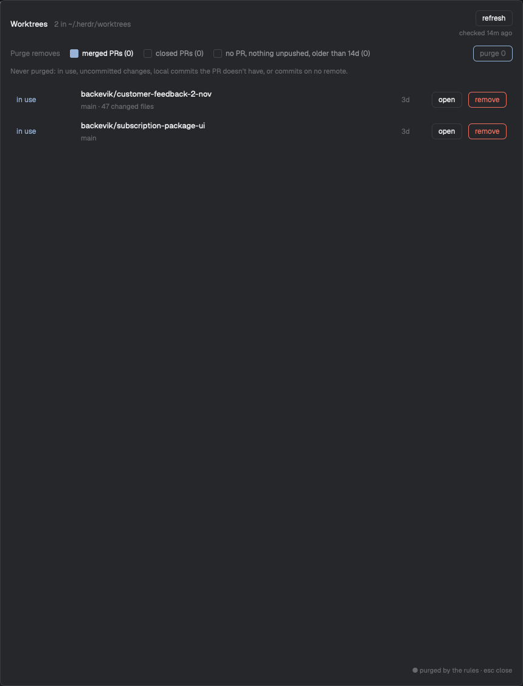

# Worktree Janitor, a Herdr mod

**See every git worktree Herdr made, why it's still there, and remove the ones you're done with.** One panel, one click to purge.



Herdr's **New worktree** puts a checkout in `~/.herdr/worktrees/<repo>/<branch>` for every task. Each one carries its own `node_modules`, build output and caches, and nothing removes them once the PR lands. A few weeks of agent work is easily 100 GB. The built-in **Remove worktree** handles one space at a time and keeps the branch.

Worktree Janitor lists every checkout in that folder with a status from its PR, its working tree and whether you have it open, and removes the checkout, its folder and its local branch in one go.

## Highlights

- **Status from the PR, not from main.** It asks GitHub (`gh`) for the branch's PR. Rebase and squash merges rewrite commits, so comparing with main says "not merged" for work that landed.
- **Safe means nothing is lost.** A merged or closed PR only counts when your local `HEAD` is the commit the PR ended on and `git status` is clean. Git-ignored files (`node_modules`, `.next`, `.venv`) don't count.
- **Never touches what you're using.** A checkout with a space, pane or live terminal in it is `in use` and never purged.
- **Purge rules you can see.** Checkboxes for merged PRs (on), closed PRs and stale checkouts with no PR (off), each with how many checkouts it matches. The conditions that always block a purge are spelled out under them.
- **Fast removal.** The folder is moved aside (an instant rename on the same disk), git and the branch are cleaned up, and the files are deleted in the background, so you don't wait for `node_modules` to be deleted file by file.
- **Opens instantly.** Results are cached. `refresh` checks everything again and the panel shows how old the check is.
- **Checks again before it deletes.** Every removal probes the checkout first. If git says something different from the cached row, nothing is removed.

## Install

Requires the [Herdr app](https://herdr.dev) (tested on 0.1.11, macOS), `git`, and the [GitHub CLI](https://cli.github.com) signed in (`gh auth status`).

**Ask your agent:**

```text
Read ~/.config/herdr-app/AGENTS.md, then add this mod: https://github.com/backevik/herdr-mods/tree/main/worktree-janitor
```

**Or by hand:**

```sh
git clone https://github.com/backevik/herdr-mods.git
cp -R herdr-mods/worktree-janitor/mods/worktree-janitor ~/.config/herdr-app/mods/
herdr-app check ~/.config/herdr-app/mods/worktree-janitor
```

Then merge [`keys.json`](keys.json) into `~/.config/herdr-app/keys.json`:

```json
{ "global": { "ctrl-alt-cmd-j": "mod.open:worktree-janitor" } }
```

Without a key, open it with `herdr-app do mod.open --name worktree-janitor`.

## Use

Press `ctrl-alt-cmd-j`. Each row is one checkout:

| Status | Means | Purged |
| --- | --- | --- |
| `merged` | The branch's PR is merged | Yes, if the rule is on and nothing local differs |
| `closed` | The PR was closed without merging | Only with **closed PRs** on |
| `no PR` | No PR for this branch | Only with **no PR, nothing unpushed, older than 14d** on |
| `PR open` | The PR is still open | Never |
| `changes` | Uncommitted or untracked files | Never |
| `in use` | A space, pane or terminal is in it | Never |
| `detached` | No branch checked out | Never |
| `PR unknown` | `gh` failed for this branch (the error is shown) | Never |
| `not a worktree` | A folder git doesn't track any more | Never |

A `●` marks the rows the current rules would purge. The line under the status says why a row is held back: `local commits differ from the PR`, `2 commits on no remote`, `47 changed files`.

- **open** switches to the checkout's space, or opens one.
- **remove** removes one checkout. A row that isn't safe turns red and asks **Are you sure?** first.
- **purge N** removes every `●` row after one **Are you sure?**. Keep the panel open until it says it's done.
- **refresh** checks every checkout and every PR again. Opening the panel only checks folders it hasn't seen.

## What this does to your machine

Worktree Janitor never runs on its own. Nothing happens until you press a button.

- **Reads** `~/.herdr/worktrees/*/*` and runs `git` in each checkout (`rev-parse`, `log`, `rev-list`, `status`).
- **Calls GitHub** through `gh pr list --head <branch>`, once per branch, on the first open and on every `refresh`. Nothing else reaches the network.
- **Stores** its rules and cache in the app's shared state (`~/.config/herdr-app/shared.json`, keys `worktree-janitor.rules` and `worktree-janitor.cache`).
- **On remove:** closes the spaces and ends the terminals inside the checkout, moves the folder to `~/.herdr/worktrees-trash/`, runs `git worktree remove --force` (the folder is already gone, so git only drops its record; on failure the folder is moved back), then `git branch -D <branch>`. A background `rm -rf` empties the trash, and opening the panel finishes any delete that was cut short.
- **Never** touches remote branches, PRs, or anything outside `~/.herdr/worktrees/<repo>/<checkout>` and the trash folder.

## FAQ

**Why `git branch -D` and not `-d`?** After a rebase or squash merge, git doesn't consider the branch merged, so `-d` refuses. The PR check above is what decides it's safe.

**What if I close the panel during a purge?** Removals that already ran are done. The background delete keeps going. The rest stay until you purge again.

**What if the cache is old?** Statuses that come from git are checked again right before anything is removed. PR state is only as fresh as the last `refresh`, which is fine for merged and closed PRs (they stay that way), but an open PR that merged since shows as `PR open` until you refresh.

**Where does the disk space go?** Into `~/.herdr/worktrees-trash/` for a moment, then it's freed as the background delete runs. Large checkouts can take a minute.

## Known gaps

- Only checkouts in `~/.herdr/worktrees` (the Herdr app's default) on this machine. Worktrees made elsewhere, or spaces on other machines, aren't listed.
- GitHub only, and the PR is found by the local branch name.
- The panel is a dialog: a click outside closes it.
- Tested on macOS only.

[RECIPE.md](RECIPE.md) is the brief to build it from scratch.

## License

[MIT](../LICENSE).
