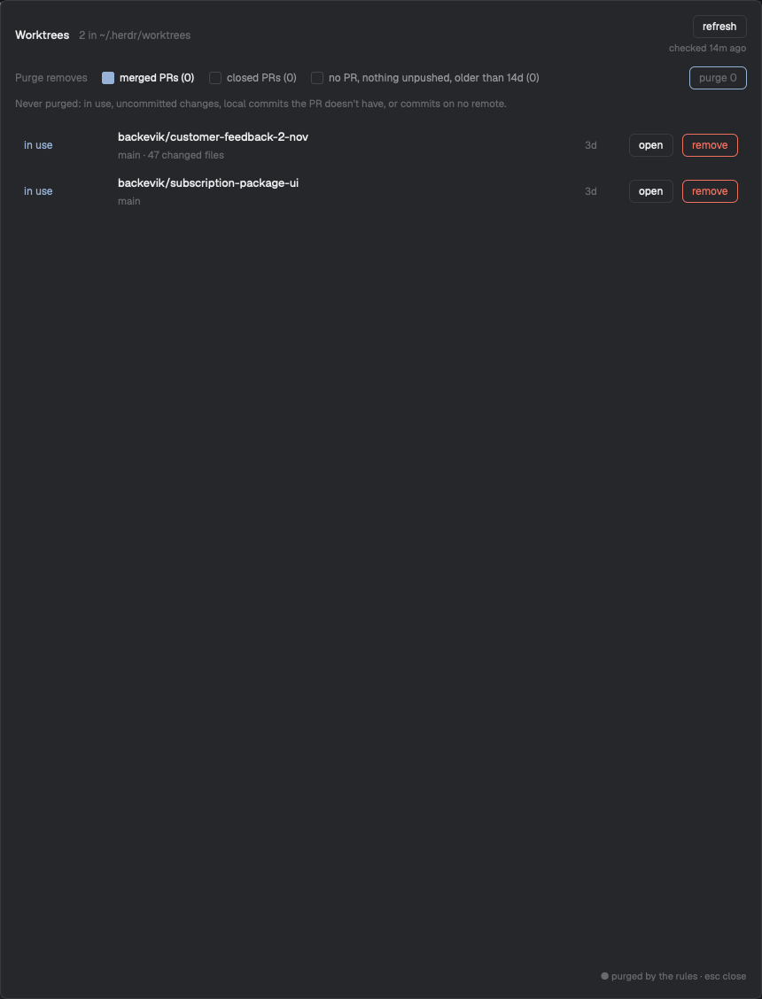

# Worktree Janitor

A dialog that lists every git worktree checkout under `~/.herdr/worktrees/<repo>/<checkout>`, each with a status from its GitHub PR, its working tree and whether a space or terminal is in it. The person removes checkouts one at a time or presses Purge to remove every checkout the ticked rules allow. Removing takes the checkout, its folder and its local branch.

## What you see

- A centered dialog, 860px wide and 80% of the window high, opened with `ctrl-alt-cmd-j`. Nothing is added to the layout.
- **Header row:** "Worktrees" (semibold, 13px, foreground), then "27 in ~/.herdr/worktrees" (12px, dim). On the right, a **refresh** button with "checked 5m ago" (11px, dim) under it ("checked just now" under a minute). While checking, the button reads "checking 12/27".
- **Rules row** (12px): "Purge removes" (dim), then three checkboxes, each a 14px rounded square (accent fill when ticked, `input` border when not) and a label with its match count:
  - "merged PRs (17)", ticked by default
  - "closed PRs (0)"
  - "no PR, nothing unpushed, older than 14d (0)"
  - On the right, **purge 17** (accent border and text).
- **Safety line** (11.5px, dim): "Never purged: in use, uncommitted changes, local commits the PR doesn't have, or commits on no remote." While removing it turns `blocked` red: "Removing. Don't close this panel until it's done."
- **The list**, scrollable with a vertical scrollbar. One row per checkout, 6px vertical padding, hover background:
  - Status, 96px wide, 12px, in its tone, with a "● " before it when the rules would purge it.
  - Branch name (foreground; the folder name when detached), and under it (11.5px, dim) the repo folder name and notes joined with " · ": "PR #6069", "47 changed files", "local commits differ from the PR", "1 commit on no remote".
  - Age of the last commit, 40px wide, dim: "40d", "3h".
  - **open** and **remove** buttons: 26px high, 10px horizontal padding, 6px radius, 1px border, 12px text. remove has a `blocked` border and text on rows that aren't safe.
- **Footer** (11px, dim, right-aligned): "● purged by the rules · esc close".
- Theme colors throughout: `popover` background, `foreground`, `muted`, `dim`, `accent`, `hover`, `border`, `input`, and the status tones below. 16px padding, 12px gaps.

| Status | Tone | When |
| --- | --- | --- |
| merged | `done` | the PR is merged |
| closed | `muted` | the PR is closed without merging |
| no PR | `dim` | no PR for the branch |
| PR open | `working` | an open PR |
| detached | `muted` | no branch checked out |
| PR unknown | `blocked` | `gh` failed; its error is the note |
| changes | `blocked` | `git status --porcelain` is not empty |
| in use | `accent` | a space folder, pane cwd or live terminal cwd is inside the checkout |
| not a worktree | `blocked` | git doesn't track the folder |

Rows are sorted in that order, then oldest commit first. "in use" wins over "changes", which wins over the PR-based statuses.

## How it behaves

- **Opening** shows the cached list at once and only checks folders the cache doesn't have, dropping folders that are gone. With no cache it checks everything. "in use" is never cached: it is worked out from live spaces, panes and terminals on every render, so it changes as spaces open and close.
- **refresh** checks every checkout and PR again, 6 at a time, and resets "checked … ago". The age redraws every 30 seconds.
- **Safe** means removing loses nothing git can't get back:
  - merged or closed: local `HEAD` equals the PR's head commit, and the tree is clean.
  - no PR: no commits on no remote, and the tree is clean.
  - never when in use, changed, detached, PR open, PR unknown or not a worktree.
- **Purge rules:** a row is purged when it is safe and its rule is ticked: merged PRs, closed PRs, or no PR with a last commit older than 14 days. Each count is how many checkouts that rule alone matches; the rules never overlap, so the ticked counts add up to the purge count. Ticking a rule saves it at once.
- **open** closes the dialog and selects the space whose folder is in the checkout, or makes a new space there.
- **remove** on a safe row removes it at once. On any other row the first click turns the button into "Are you sure?" and the note into "Not safe: <notes>. Click again to remove."; the second click removes it. While it runs the button shows a spinning ring and "removing…".
- **purge N** is disabled at 0. The first click shows "Are you sure?" in `blocked`; the second removes every purge row one after another. The button shows the spinner and "Removing…", the safety line warns not to close the panel, and refresh, remove and purge are disabled. At the end a toast says "Removed N worktrees" with "Disk space frees up in the background." (`success`), or "N failed" (`warning`); failures are listed in `blocked` text above the footer.
- **Removing one checkout:**
  1. Probe it again. If branch, head, commits on no remote, changed files or tracking differ from the row, update the row, remove nothing and report "changed since it was checked, look again".
  2. Close every space whose folder or pane cwd is inside it (`space.close` with `confirmed: true`) and kill live terminals whose cwd is inside it.
  3. Move the folder to `~/.herdr/worktrees-trash/<repo>-<checkout>-<ms>`.
  4. `git worktree remove --force <path>` from the main checkout. The folder is gone, so git only drops its record. If it fails, move the folder back and report git's error.
  5. Drop the row from the cache, then `git branch -D <branch>`. A failure there reports "checkout removed, branch kept: …".
  6. After a row or a whole purge, delete the trash in the background.
- Esc or a click outside closes the dialog.

## Built from

- **One mod**, `mods/worktree-janitor/`: `main.js`, `mod.json` and `spinner.svg` (a 24px ring: a faint full circle and a quarter arc, `stroke="currentColor"`). No `layouts/` folder.
- **`mod.json`:** `{ "place": "none", "title": "Worktrees", "overlay": { "kind": "dialog", "width": 860, "height": 0.8 } }`.
- **`keys.json` snippet**, merged into the person's keys: `{ "global": { "ctrl-alt-cmd-j": "mod.open:worktree-janitor" } }`.
- **A `View`** using `gpui-kit` (`div`, `svg`), `gpui-base` (`v_flex`, `h_flex`, `Scrollbar`) and `herdr` (`exec`, `home`, `spaces`, `panes`, `terminals`, `theme`, `run`, `notify`, `props`, `closeOverlay`, `shared`, `setShared`). Buttons and checkboxes are plain styled `h_flex` and `div` elements with `on_click`. The spinner is `svg("mods/worktree-janitor/spinner.svg").w(12).h(12).spin(900)`.
- **Folder scan:** `fs.readdir(…, { withFileTypes: true })` from `fs/promises`, two levels under `~/.herdr/worktrees`.
- **One `sh -c` probe per checkout**, path as `$1`, printing tab-separated lines: `git rev-parse --show-toplevel`, `git rev-parse --path-format=absolute --git-common-dir` (the main checkout; strip a trailing `/.git`), `git symbolic-ref --short -q HEAD`, `git rev-parse -q --verify HEAD`, `git log -1 --format=%ct`, `git rev-list --count HEAD --not --remotes`, and `git --no-optional-locks -c core.fsmonitor=false status --porcelain | wc -l`. A nonzero exit, or a toplevel that isn't the folder, means "not a worktree".
- **PR lookup:** `gh pr list --head <branch> --state all --limit 20 --json number,state,headRefOid,url`, run in the main checkout. Take the open PR if there is one, else the highest number.
- **Commands:** `space.close`, `terminal.kill`, `space.select`, `space.new`.
- **State:** `shared("worktree-janitor.rules")` holds `{ merged, closed, stale, staleDays }` (defaults `true, false, false, 14`). `shared("worktree-janitor.cache")` holds `{ at, list }`, written after every check and every removal.
- **Background delete:** `sh -c '[ -d "$1" ] || exit 0; (for d in "$1"/*; do [ -e "$d" ] && rm -rf "$d" & done; wait) >/dev/null 2>&1 &'` with the trash folder as `$1`. It also runs when the mod opens, to finish an earlier delete.

## Watch out

- **Don't compare with main.** Rebase and squash merges rewrite commits, so `git branch --merged` and `git cherry` call landed work unmerged. The PR's `headRefOid` against local `HEAD` is the check. For the same reason the branch needs `-D`, not `-d`.
- **`exec` stops a program after 30 seconds.** `git worktree remove` on a checkout with `node_modules` can take longer and would be cut off mid-delete. Move the folder first (same volume, an instant rename), then let git forget the missing path, then delete in a detached background shell. Detached children outlive the `exec` call and the dialog.
- **Removals run one after another.** In parallel, `git branch -D` contends for ref locks. After the move, every step is fast anyway.
- **Ignored files are fine.** `git status --porcelain` leaves out ignored files, and `git worktree remove` deletes them without `--force`.
- **A cached row can be stale.** Probe again right before removing, and refuse when git state changed. PR state isn't checked again: merged and closed PRs don't change back.
- **`shared()` persists and re-renders every mod on set.** Write the cache after a check or removal, not per row while checking.
- **`localStorage` is per mod copy**, and every `mod.open` makes a new copy, so it can't hold the cache.
- Only touch folders exactly two levels under `~/.herdr/worktrees`, and refuse any other path before moving it.
- A click outside a dialog closes it. Keep long work in `cx.spawn` and never keep a `cx`.
- Assumes `git`, a signed-in `gh` with GitHub remotes, `sh`, `mv` and `rm` on this machine. Spaces on other machines are not considered. Before adding it, tell the person that it runs programs (`git`, `gh`, `sh`, `mv`, `rm`), reaches GitHub through `gh`, deletes folders and local branches, and closes spaces and terminals in removed checkouts.

## Done when

- `herdr-app check mods/worktree-janitor` passes.
- `ctrl-alt-cmd-j` opens the dialog; opening it a second time shows the list at once, with "checked … ago" under refresh.
- Every checkout in `~/.herdr/worktrees/*/*` has a row, and its status and notes match `git status`, `git rev-list` and `gh pr list --head` run by hand.
- A checkout open in a space shows "in use" and is never counted for purge; closing the space changes it without a refresh.
- Ticking and unticking a rule changes the purge count by that rule's number, and the choice is still there after closing and reopening.
- remove on a merged, clean row deletes the folder, the `git worktree list` entry and the local branch, and the row disappears.
- remove on an unsafe row asks "Are you sure?" first.
- Committing in a checkout after its row was cached, then pressing remove, removes nothing and reports that it changed.
- Purge shows the spinner and "Removing…", then a toast, and `~/.herdr/worktrees-trash` is empty shortly after.
